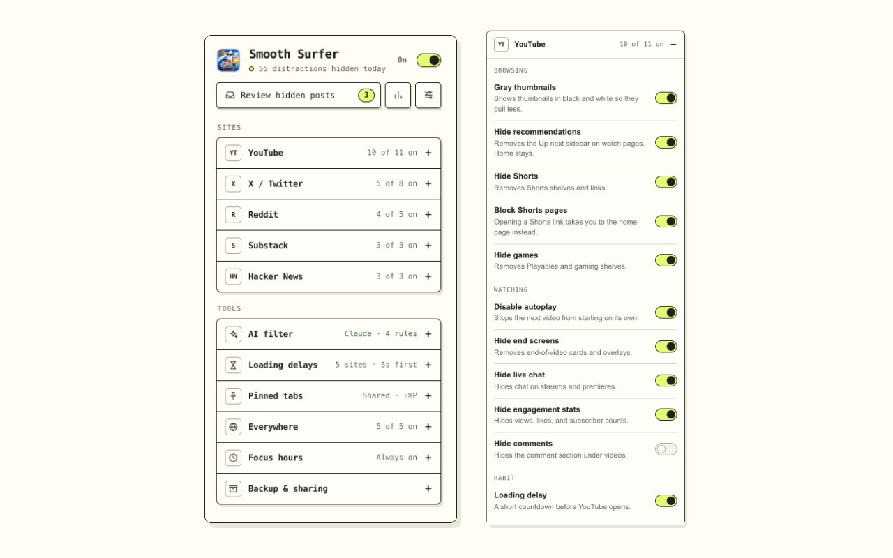
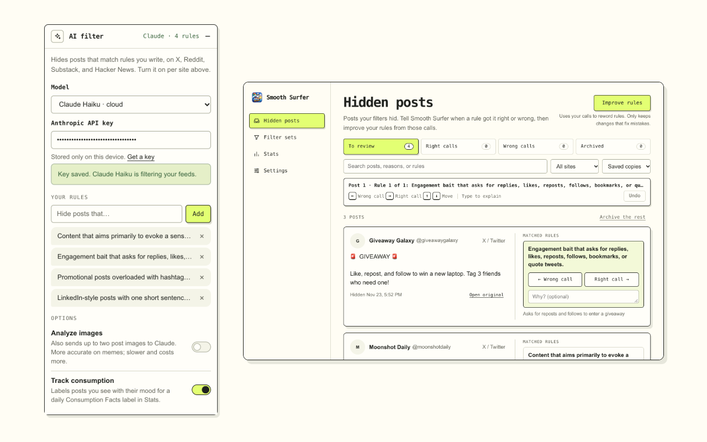
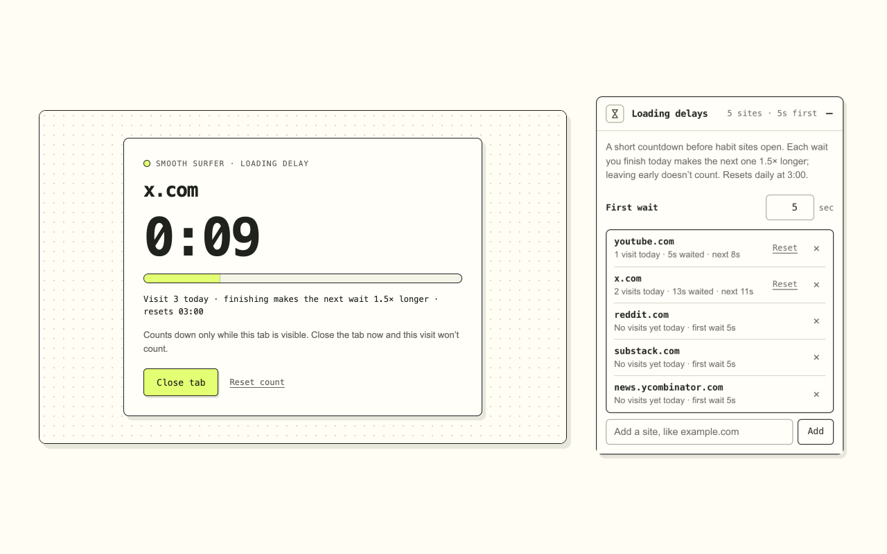
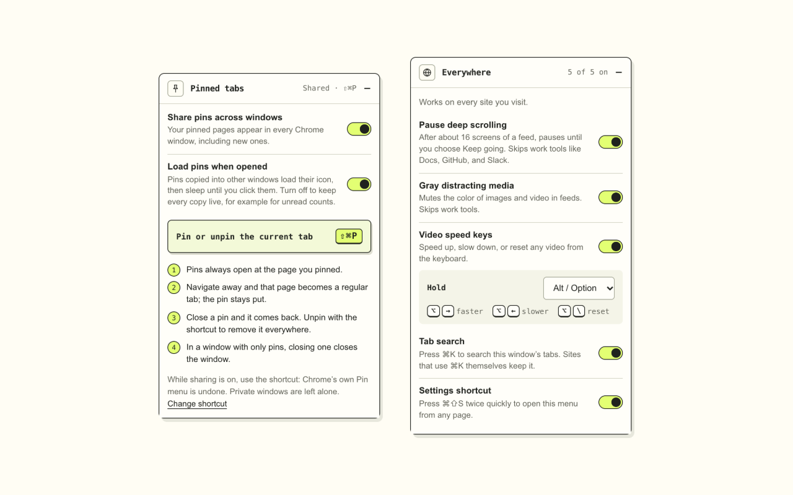
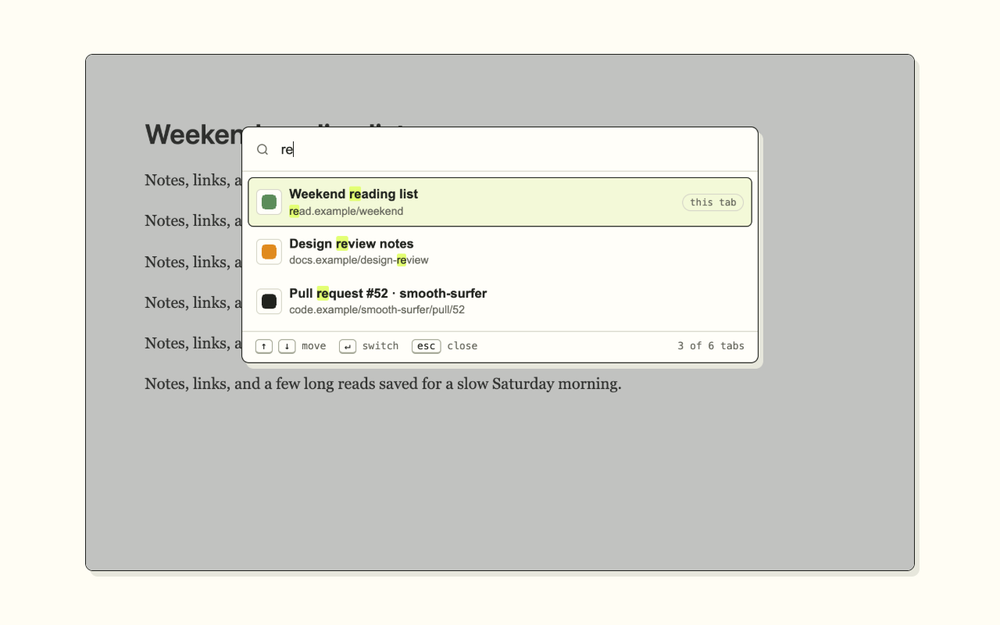
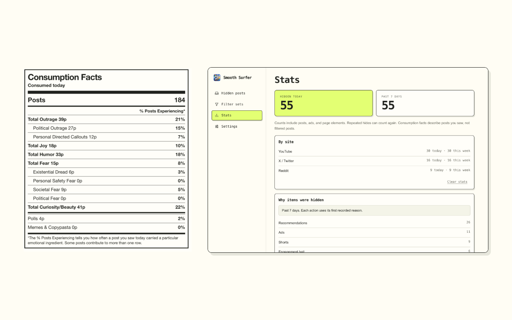

# Smooth Surfer

[](https://github.com/nishu-builder/smooth-surfer/actions/workflows/ci.yml)
[](https://chromewebstore.google.com/detail/smooth-surfer/cgmineplcpnmdfokdblnnapnbpknfghe)

A Chrome extension for making the web less distracting. Some of the things you
can do with it:

- Make things hijack your attention less: hide view counts, Shorts, suggested
  next videos, make thumbnails, pictures and videos more grayscale, auto-select
  ‘Following’ feeds over ‘For you’, hide ‘recommended’ posts
- Filter out content you don’t like (e.g. posts on X/Substack/Reddit) according
  to LLM-judged rules you set up. And you can review which were filtered out
  later and note if you agree or not, and why
- Stop bad habits: can introduce delays that grow with each visit before
  loading sites you’re prone to getting distracted by
- Use some sorely missing browser controls: pinned tabs that work more like
  Arc’s, keyboard shortcuts for changing the speed of a video on your screen,
  search across tabs
- See an unserious reflection of your information diet, a la Emmett’s idea
  [here](https://x.com/eshear/status/1534692002952097792)

It’s on the [Chrome Web Store](https://chromewebstore.google.com/detail/smooth-surfer/cgmineplcpnmdfokdblnnapnbpknfghe),
or you can [run it from source](#install). There’s no account, no analytics,
and no server of mine involved. The rest of this page is the detail on each of
the above.

## Making sites less attention-grabbing



Each supported site has its own list of switches in the toolbar menu. Most are
on by default.

| Site | Switches |
| --- | --- |
| YouTube | Gray thumbnails, hide recommendations, Shorts, games, live chat, end screens, engagement counts, and comments; block Shorts pages; disable autoplay |
| X / Twitter | Remove feed ads; hide reposts, quote posts, video posts, and trends; prefer the Following tab |
| Reddit | Remove feed ads; hide recommendations and comments |
| Substack | Hide recommendations |
| Hacker News | Hide scores |

Two more apply on every site except work tools like Docs, GitHub, and Slack:

- **Gray distracting media** mutes the color of images and video in feeds.
- **Pause deep scrolling** stops you after about 16 screens of a feed until you
  choose Keep going.

**Focus hours** limits all of this to set times of day, including overnight
ranges.

## Filtering posts with rules you write



On X, Reddit, Substack, and Hacker News you can write rules like “engagement
bait” or “posts that stoke FOMO”, and an LLM hides the posts that match. The
menu calls this the AI filter. It starts with four rules you can edit.

- **Claude Haiku 4.5** (default) runs with your own Anthropic API key. Optional
  **Analyze images** also sends up to two public post images; it is off by
  default and adds cost and latency.
- **Gemini Nano** (experimental) runs on this computer through Chrome’s
  built-in model. It handles text only and never falls back to the cloud. See
  [on-device setup and limits](docs/LOCAL_MODELS.md).

If the filter is on but can’t run (no key, or no model), the menu says so, with
one click to set it up or turn it off. If a request fails, posts stay visible
and retries are spaced out. On X, posts stay in place while they are checked;
matches fade out, and removals above your reading position keep their space so
the page doesn’t jump.

On X, the **Less like this** button beside a post opens a rule editor. Write a
rule, or choose **Suggest rules** and edit one before adding it. Suggestions
never change your rules on their own.

### Reviewing what was hidden

Every post the filter hid is listed on the **Hidden posts** page with the rule
that matched. Mark each one a **Right call** or **Wrong call** (← and → on the
keyboard) and optionally say why. **Improve rules** then has the model propose
rewordings and replays your saved examples against them. A revision is kept
only if it fixes mistakes without introducing new ones, and the last 30
revisions can be undone. It is calibration against your examples, not a
guarantee; see [the algorithm](docs/CALIBRATION.md).

<details>
<summary>Inboxes, keyboard, and storage</summary>

- Inboxes: **To review**, **Right calls**, **Wrong calls**, and **Archived**.
  Counts are per rule and post, so a post that matched two rules counts twice.
- Keys: ← Wrong call, → Right call, ↑/↓ move, Cmd/Ctrl+Z undo. Start typing to
  explain the selected call; Enter returns to the keys.
- X posts show as native embeds, with saved copies as a fallback.
- Up to 2,000 hidden and archived posts within 6 MB stay on this device. Hidden
  posts expire after seven days; archived ones don’t. **Archive the rest** moves
  everything still to review into Archived. Calls are stored separately (up to
  2,000 within 2 MB), so archiving never erases them.
- Improving rules runs in the background and resumes after Chrome restarts.

</details>

**Filter sets** save named bundles of rules, preview the Quiet browsing and Work
presets, and import or export sets as JSON. Importing adds only what you check,
up to 20 sets per device, and never includes API keys.

## Delays before distracting sites



Sites on the list open behind a countdown that gets longer each time you visit
that day. YouTube, X, Reddit, Substack, and Hacker News are on the list by
default, and you can add any site from the menu, including the one you’re on.

<details>
<summary>How the countdown grows</summary>

- The first wait is 1 second by default (1–300 seconds). Each wait you finish
  that day makes the next one 1.5× longer, up to 20 minutes. Counts reset at
  03:00 local time.
- The countdown runs only while the tab is visible. Closing the tab early doesn’t
  advance the next wait. **Reset count** returns to the first wait.
- A finished tab keeps its pass across reloads, and waits again after 30 minutes
  in the background. `twitter.com` and `x.com` cover each other.
- Stats shows loads, finished waits, early exits, resets, time waited, and visits
  by hour.

</details>

## Browser controls



### Pinned tabs

Press **Cmd+Shift+P** (Alt+P on Windows and Linux) to pin or unpin a tab. Pins
appear in every regular Chrome window, including new ones, and always sit at
the page you pinned. Sharing is on by default; turn it off to keep pins per
window.

<details>
<summary>How shared pins behave</summary>

- Navigating away from a pin moves that page into a regular tab (keeping its
  history) and restores the pin at its saved URL. Reloading keeps it pinned.
- Closing a pin or a window keeps your pins; a closed pin comes back. In a window
  that holds only pins, closing one (Cmd+W) closes the window instead. Unpinning
  with the shortcut removes a pin everywhere without closing its copies.
- Copies in other windows load once for their title and icon, then sleep until
  you click them, so they use no memory in the meantime. The window you pinned a
  page in keeps it live. Turn off **Load pins when opened** to keep every copy
  live, for example for unread counts.
- While sharing is on, the shortcut is the only way to change pins. Pinning or
  unpinning from Chrome’s tab menu is undone. Change the shortcut at
  `chrome://extensions/shortcuts`.
- Drag pins to reorder them; new windows use the last order you arranged.
- Private windows are excluded, and saved URLs stay on this device. Chrome may
  still ask you to press Cmd+W twice to close a pinned tab; extensions can’t
  change that.

</details>

### Video speed keys

On any site, hold Alt/Option with → or `]` to speed up the video on screen, ←
or `[` to slow it down, and `\` to reset. The modifier is configurable, or off
entirely (brackets only).

### Tab search



Press Cmd+K (Ctrl+K) to search this window’s tabs by title or address, then
Enter to switch. Sites that use Cmd+K themselves, like GitHub or Slack, keep
it. It can’t open on Chrome’s own pages, such as the New Tab page; Chrome’s
Search tabs (Cmd+Shift+A) covers every window.

## Consumption Facts



With **Track consumption** on, the filter’s model also labels the mood of the
posts you actually saw, and the Stats page shows the day’s totals as a
nutrition label: what share of your feed was outrage, humor, fear, and so on.
It is not a serious measurement. The same page counts what was hidden per site
and why.

## Other settings

- **Settings shortcut:** press Cmd+Shift+S (Ctrl+Shift+S) twice to open the menu.
- **Backup:** export or import every setting as JSON. Your API key is never
  included.

## Privacy

Settings sync with your Chrome profile; your API key, hidden posts, calls, and
statistics stay on this device. Post content leaves the browser only when you
choose Claude: then feed text (and images, if you turn that on) goes to Anthropic
with your own key. See [PRIVACY.md](PRIVACY.md) for details.

## Install

The [Chrome Web Store build](https://chromewebstore.google.com/detail/smooth-surfer/cgmineplcpnmdfokdblnnapnbpknfghe)
updates automatically, but each version waits on Google’s review, so it can be
behind `main`.

To run it from source instead:

```sh
git clone git@github.com:nishu-builder/smooth-surfer.git
```

1. Open `chrome://extensions` and turn on **Developer mode**.
2. Click **Load unpacked** and select the `smooth-surfer` folder.
3. After pulling changes, reload the extension there and refresh open tabs.

The store build and an unpacked copy are separate extensions with separate
settings. Run one at a time, and use Backup to move settings between them.

### iPhone

The repository also builds an iPhone Safari extension. It works on websites in
Safari, not in native apps, and uses Claude for the AI filter, since Chrome's
built-in model isn't available on iOS. It isn't on the App Store; see the
[iPhone build instructions](docs/iphone.md) and [platform scope](docs/PLATFORM_SCOPE.md).

## Development

The extension is plain JavaScript, HTML, and CSS with no runtime dependencies,
so the tests run without installing anything:

```sh
npm run check     # syntax checks, unit tests, and headless Chrome tests
npm ci            # dev tools for the commands below
npm run verify    # ESLint + Prettier check + npm run check
```

The Chrome tests that load the real extension need a build that honors
`--load-extension`. Branded Chrome 137+ doesn't; point `CHROME_BIN` at Chrome
for Testing (CI downloads it automatically on Linux).

- [Product style guide](docs/STYLE_GUIDE.md): the paper-and-ink look, terms,
  and interface principles.
- Store and README graphics: `node scripts/capture-store-assets.mjs` renders
  everything in [docs/store-assets](docs/store-assets) from the real extension.
- [Releasing](docs/RELEASING.md): how a `v*` tag becomes a Chrome Web Store
  release. See the [changelog](CHANGELOG.md) for what changed.
- Planned work is in [TODO.md](TODO.md).
